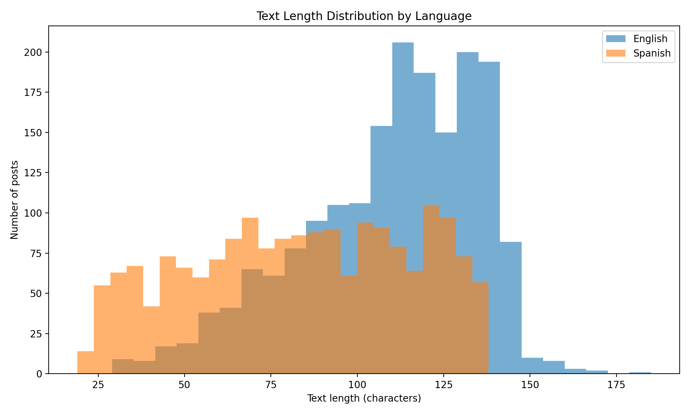
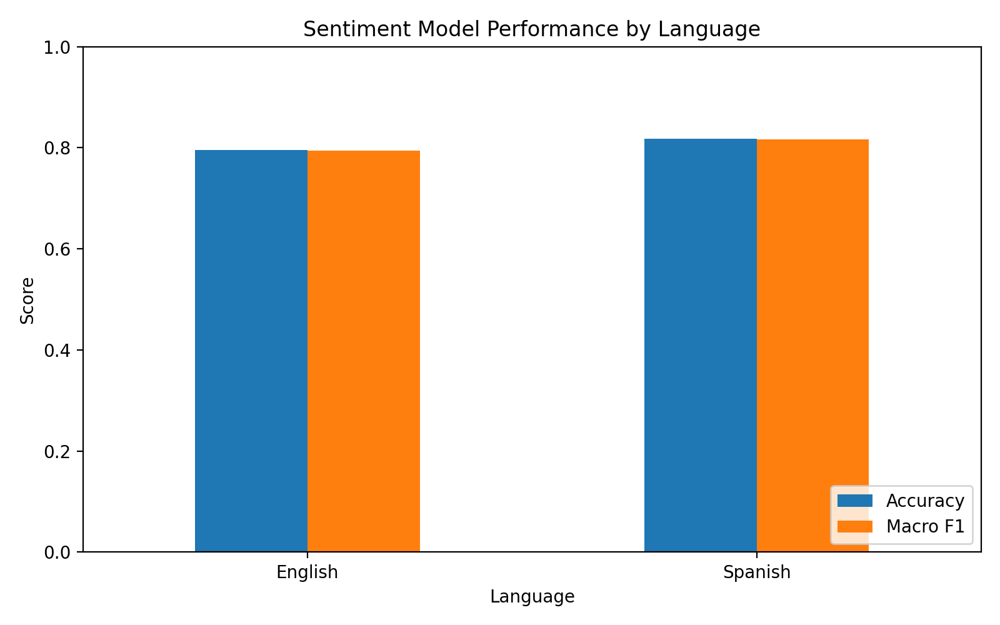
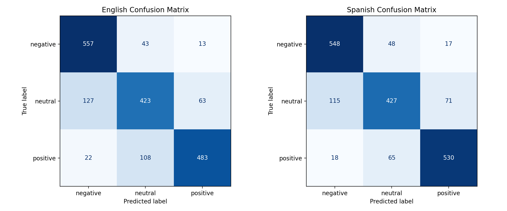
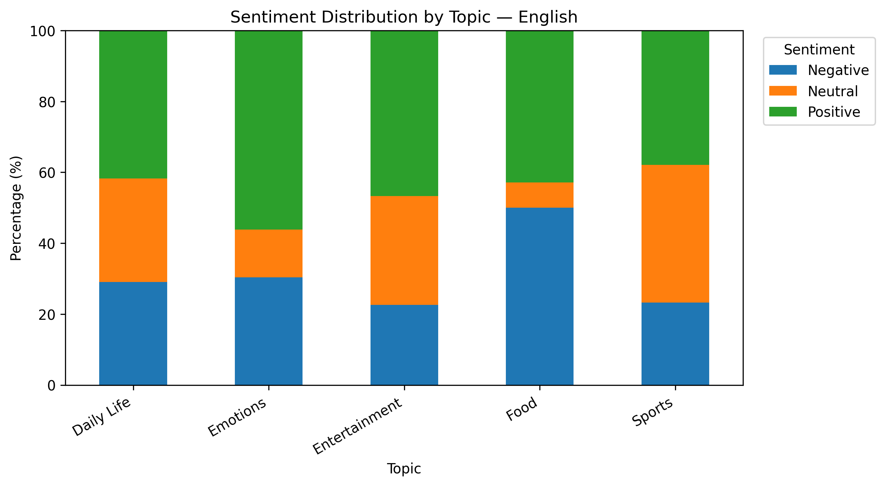
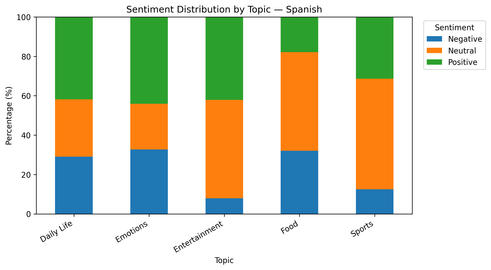

# Cross-Cultural AI Risk & Business Analytics

## Project Overview

This project explores multilingual sentiment analysis using English and Spanish social media text. It combines exploratory data analysis, AI model evaluation, error analysis, keyword-based topic classification, manual validation, and business insight development.

The goal is to understand how sentiment classification performs across languages, identify potential reliability issues, and explore how multilingual text analysis can support content operations and business research.

**Project focus:** Multilingual AI evaluation, cross-cultural content analysis, and business insights.

**Tools:** Python, pandas, matplotlib, scikit-learn, Google Colab, GitHub.

## Business Value

This project demonstrates how data analysis and multilingual AI evaluation can support exploratory content research.

Key capabilities demonstrated:

- **Data analysis:** Compared text characteristics and sentiment distributions across English and Spanish datasets.
- **AI evaluation:** Evaluated classification performance using accuracy, macro F1-score, and class-level metrics.
- **Quality assurance:** Investigated classification errors and manually audited keyword-based topic labels.
- **Business insights:** Identified patterns requiring further investigation and proposed validation steps for content operations.

The results are exploratory. They do not establish cultural causes, actual user preferences, or measurable business impact.

## Project Workflow

1. Explore and compare English and Spanish datasets.
2. Analyse text length and sentiment label distributions.
3. Evaluate multilingual sentiment classification performance.
4. Investigate model errors and class-level performance.
5. Assign topics using keyword-based rules.
6. Manually audit a sample of topic assignments.
7. Compare sentiment distributions across topics and languages.
8. Translate data findings into cautious, actionable business recommendations.

## Key Findings

### 1. Dataset

The training split contains 1,839 English posts and 1,839 Spanish posts. Each language has 613 examples for each of the three sentiment labels.

The official test split contains 870 examples for each language.

Sentiment labels:

- `0`: Negative
- `1`: Neutral
- `2`: Positive

The balanced training labels are useful for comparing model performance, but they do not necessarily reflect real-world sentiment distributions.

### 2. Text Length Comparison

Average text length in the training data:

- English: 109.57 characters
- Spanish: 83.39 characters
- Difference: 26.18 characters

This is a descriptive difference in the sampled text. It does not establish why the difference exists or imply that one language communicates more effectively than the other.

### 3. Sentiment Model Evaluation

Model: `cardiffnlp/twitter-xlm-roberta-base-sentiment`

Official test-set results:

| Metric | English | Spanish |
|---|---:|---:|
| Accuracy | 0.7322 | 0.6966 |
| Macro F1-score | 0.7301 | 0.6933 |

In this evaluation, the model performs better on the English test split than on the Spanish test split. This is a result for these particular datasets, not proof of a general performance gap across all English and Spanish content.

Class-level test-set F1-scores:

| Sentiment | English F1 | Spanish F1 |
|---|---:|---:|
| Negative | 0.79 | 0.75 |
| Neutral | 0.63 | 0.58 |
| Positive | 0.77 | 0.75 |

Neutral sentiment has the lowest F1-score in both languages, making it a useful priority for further error analysis.

### 4. Model Performance Visualisation

#### Performance Comparison Across Languages

#### Confusion Matrices

These visualisations help compare model performance and identify patterns in classification errors.

## Error Analysis

The project examines classification errors by language and sentiment class.

The results suggest that neutral sentiment is more difficult for the model to classify than negative or positive sentiment in the official test evaluation.

This matters for content analysis because sentiment predictions may be less reliable for ambiguous or neutral posts. Predicted labels should not be treated as verified user opinions without additional validation.

See:

- `day3_error_summary.csv`
- `day4_error_analysis_report.md`
- `day5_test_evaluation_report.md`
- `day5_test_set_comparison.csv`
- `day5_classification_report.csv`

## Topic Analysis and Manual Validation

Keyword-based rules were used to assign posts to five exploratory topics:

- Daily Life
- Emotions
- Entertainment
- Food
- Sports

The project compares the original keyword-based topic distribution with a refined set of rules for selected topics.

The refined rules reduce the number of matches for Daily Life and Sports. A lower match count does not, by itself, prove that classification quality improved.

### Manual Audit Results

A small sample of topic assignments was manually reviewed.

| Language and Topic | Reviewed | Relevant | Precision |
|---|---:|---:|---:|
| English — Daily Life | 10 | 7 | 70.0% |
| English — Sports | 10 | 9 | 90.0% |
| Spanish — Daily Life | 9 | 9 | 100.0% |
| Spanish — Sports | 6 | 6 | 100.0% |
| **Total** | **35** | **31** | **88.6%** |

One uncertain case was excluded from the precision calculation.

These results are based on small samples. In particular, the 100% precision figures for Spanish topics should not be interpreted as proof of perfect classification. The audit also does not measure recall, so it cannot tell us how many relevant posts the keyword rules missed.

Related files:

- `topic_manual_audit_labeled.csv`
- `day6_topic_audit_report.md`
- `day7_topic_distribution_original.png`
- `day7_topic_distribution_original.csv`
- `day7_manual_audit_precision.png`

## Day 8: Topic-Based Sentiment Analysis

Sentiment distributions were compared across the five topics for English and Spanish posts.

A total of 1,362 unique posts had at least one matched topic. Posts without a topic match were excluded. Posts matching multiple topics were counted in each matching topic, so topic counts should not be added together as if every post belonged to exactly one topic.

### Daily Life

The positive sentiment shares were very similar:

- English: 41.7%
- Spanish: 41.8%

This is a descriptive similarity within the current dataset. It does not prove that user preferences are the same across languages.

### Emotions

The positive sentiment shares were:

- English: 56.1%
- Spanish: 44.0%

The difference is 12.1 percentage points. This is a pattern worth investigating, not evidence of a cultural or linguistic cause.

Further checks should examine topic classification quality, manually reviewed examples, and sentiment model errors.

### Small Topic Groups

Some groups contain few matches, including English Food and Spanish Sports. Their percentages may be unstable and should not be used alone to justify content strategy decisions.

### Sentiment Distribution Charts

#### English

#### Spanish

Related files:

- `day8_topic_sentiment_report.md`
- `day8_topic_sentiment_counts.csv`
- `day8_topic_sentiment_percentages.csv`

## Day 9: Business Insights

The analysis translates descriptive findings into possible next steps for content operations and multilingual AI evaluation.

### Insight 1: Use Daily Life as a Comparison Case

The English and Spanish positive sentiment shares are nearly identical in this sample.

**Suggested action:** Review examples from both languages to check whether the topic definitions are applied consistently.

### Insight 2: Investigate the Emotions Difference

The positive sentiment share differs by 12.1 percentage points between the two language groups.

**Suggested action:** Manually review examples and compare model errors before proposing explanations or changing content decisions.

### Insight 3: Be Cautious with Small Samples

Some topic groups contain very few matched posts.

**Suggested action:** Review additional examples or collect more relevant observations before drawing strong conclusions.

### Potential Business Applications

For content operations, topic-based sentiment analysis may help teams identify categories that warrant further review.

For multilingual AI quality assurance, it can help identify where model evaluation and manual checks should be prioritised.

These applications remain exploratory. The current project does not measure actual engagement, satisfaction, conversion, or business impact.

Related files:

- `day9_business_insights.csv`
- `day9_business_analysis_report.md`

## Repository Contents

| File | Description |
|---|---|
| `README.md` | Project overview, findings, and limitations |
| `day2_analysis.py` | Exploratory analysis code |
| `day2_analysis_report.md` | Exploratory analysis report |
| `text_length_summary.csv` | Text length summary statistics |
| `text_length_comparison.png` | Text length comparison chart |
| `day3_error_summary.csv` | Model error summary |
| `day3_model_comparison.png` | Model performance comparison chart |
| `day3_confusion_matrix.png` | Confusion matrix visualisation |
| `day4_error_analysis_report.md` | Error analysis report |
| `day5_test_set_comparison.csv` | Test-set comparison results |
| `day5_classification_report.csv` | Classification metrics by class |
| `day5_test_evaluation_report.md` | Official test-set evaluation report |
| `topic_manual_audit_labeled.csv` | Manually reviewed topic assignments |
| `day6_topic_audit_report.md` | Topic audit report |
| `day7_topic_distribution_original.png` | Topic distribution under original keyword rules |
| `day7_manual_audit_precision.png` | Manual audit precision chart |
| `day7_topic_distribution_original.csv` | Topic counts under original keyword rules |
| `day8_topic_sentiment_report.md` | Topic-based sentiment analysis report |
| `day8_sentiment_distribution_english.png` | Topic-level sentiment chart for English |
| `day8_sentiment_distribution_spanish.png` | Topic-level sentiment chart for Spanish |
| `day8_topic_sentiment_counts.csv` | Sentiment counts by language and topic |
| `day8_topic_sentiment_percentages.csv` | Sentiment percentages by language and topic |
| `day9_business_insights.csv` | Summary of business findings and next steps |
| `day9_business_analysis_report.md` | Business recommendations and limitations |

## Methods

The project uses Python and pandas for data processing, matplotlib for visualisation, and scikit-learn metrics for model evaluation.

The analysis includes:

- Descriptive statistics
- Accuracy and macro F1-score
- Class-level classification metrics
- Confusion matrix and error analysis
- Keyword-based topic assignment
- Manual precision audit
- Topic-level sentiment distributions

## Limitations

1. The dataset may not represent all English- or Spanish-speaking users.
2. Balanced training labels do not necessarily reflect real-world sentiment prevalence.
3. Model predictions may contain errors, especially for neutral sentiment.
4. Keyword-based topic rules may produce false positives and miss relevant posts.
5. Manual validation covered only a small sample and did not measure recall.
6. Some topic groups contain few observations.
7. Posts may match multiple topics, resulting in repeated counts across topic groups.
8. Observed language differences do not establish cultural causes.
9. Sentiment distributions are not direct measures of user preferences or business performance.
10. The analysis is exploratory and requires further validation before operational decisions.

## Reproducibility

The project was developed using Python in Google Colab. Analysis outputs and reports are stored in this repository.

To reproduce the analysis, use the corresponding scripts or notebooks and ensure that the dataset and model are available. Dataset and model access may require following their original hosting instructions.

## Conclusion

This project demonstrates an end-to-end workflow for exploratory multilingual text analysis: from data exploration and model evaluation to error investigation, topic validation, and business insight development.

The key lesson is that useful AI analysis requires more than model scores. Reliable interpretation also depends on data quality, classification validation, sample size, and clear communication of uncertainty.
